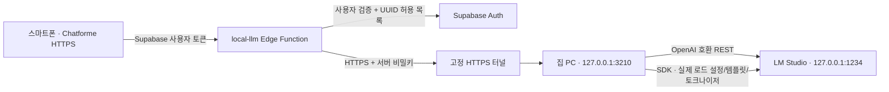

# Local (LM Studio) 연동

## 조사 결과와 연결 구조

기준 저장소: `tlsgud08/chatforme`, 작업 브랜치: `feat/lm-studio-provider`.
기존 앱은 Vite/React PWA를 Vercel에 정적으로 배포하며, Supabase Auth/DB/RLS를 사용한다.
`ChatPage.send` → `assemblePrompt` → `llm.generate` → OpenRouter Adapter가 브라우저에서 직접 API를 호출한다.
OpenRouter의 `session_id`, reasoning, usage/cost, 수동 `cache_control`, 스트리밍 파서와 모델 목록/가격 집계는 그대로 사용한다.



외부 웹사이트의 `localhost`는 방문 중인 스마트폰을 뜻한다. 브라우저에서 PC로 직접 요청하지 않는다.
브라우저에는 기존 공개 Supabase 주소/anon 키와 사용자 로그인 토큰만 있고, 터널 주소·게이트웨이 비밀키·LM Studio API 토큰은 없다.
게이트웨이와 LM Studio는 PC의 loopback에만 바인딩한다. 공유기 포트 포워딩과 LM Studio의 CORS 개방은 필요하지 않다.

Supabase 호스팅 Edge Function의 최대 실행 시간은 무료 150초, 유료 400초다.
긴 프리필을 함수 하나가 기다리지 않도록 `start → poll(cursor) → cancel` 프로토콜을 사용한다.
LM Studio → PC는 실제 SSE 스트리밍이며, 앱은 500ms 간격의 짧은 인증 요청으로 새 본문을 받아 기존 `onChunk`/초안 저장 경로에 전달한다.
요청 ID로 중복 생성을 막고, 폴링이 90초간 끊기면 PC가 생성을 취소한다.
완료/오류 결과는 재수신용으로 RAM에 10분 보관하고 삭제한다. 프롬프트·KV 캐시를 디스크에 저장하지 않는다.

## 유지되는 동작과 설정 범위

- DB 스키마/마이그레이션 변경 없음. 기존 메시지/요약/턴/비용/RLS/RPC 데이터를 수정하는 설치 작업 없음.
- 기본 제공자는 OpenRouter. 설정 → API · 모델에서 API 키 위에 제공자 선택을 추가한다.
- Local 선택 시 개선형/레거시 상단 Inuchat 옆에 작은 `Local` 표시가 나타난다.
- 제공자, 기본/요약 Local 모델, Top-P, 방별 Local 모델은 `inuchat.local.<사용자 UUID>`에 분리 저장한다. 다른 브라우저/기기에서는 다시 선택한다.
- 기존 `profiles.default_model`, `sessions.model_override`, OpenRouter 키/즐겨찾기/reasoning/캐시 설정에 Local 모델 ID를 쓰지 않는다. OpenRouter로 돌아가면 기존 설정을 사용한다.
- 방별 모델은 세션 메뉴 → AI 설정, 방별 요약 모델은 메모리에서 선택한다. 비우면 Local 기본값을 상속한다.
- 개인챗, 리롤, 이어서 생성, 일반/병합/전달용 요약, 멀티챗의 기존 claim/commit/복구 규칙을 사용한다. 멀티챗의 담당 PC/사용자 배정 규칙도 그대로다.
- 정보 접근 관리가 켜져 있으면 기록 추출도 선택한 Local 모델을 사용한다. OpenRouter 전용 Jev 탐지는 건너뛰고 로컬 추출을 수행한다. 지원 여부가 불명확한 `response_format`은 보내지 않고 JSON 스키마를 지시문으로 전달하며 기존 추출 검증을 유지한다.
- 작품, 결합 작품, 페르소나, 플러그인, 유저 노트, 요약, 테마/상태창 프롬프트를 기존 조립 함수로 만든다. 명시적으로 선택한 요약의 원문 제외 규칙도 유지한다.
- Local 생성/요약/정보표 비용은 0. 기존 누적 OpenRouter 비용을 초기화하지 않는다. 캐시 읽기 토큰은 서버가 보고한 경우만 표시하고 추정 적중을 청구 데이터처럼 기록하지 않는다.

## PC 준비

Node 22 이상과 LM Studio의 SDK/API 지원 버전이 필요하다. 고정 SDK는 `@lmstudio/sdk@2.1.0`이다.
LM Studio에서 사용할 LLM을 **미리 로드**하고 컨텍스트를 설정한 뒤 Developer의 로컬 서버를 켠다.
100K 이상 입력에는 **입력 + 출력 예약량 + 32토큰**보다 큰 실제 로드 컨텍스트와 충분한 RAM/VRAM이 필요하다.
다운로드된 모델의 학습상 최대 길이는 실제 로드 길이가 아니다.

```bash
cd tools/lm-studio-gateway
npm ci
cp .env.example .env
```

PC의 `.env`를 편집한다. `GATEWAY_SECRET`은 암호학적으로 무작위인 32자 이상으로 생성하고 서버에도 같은 값을 설정한다.
예: `node -e "console.log(require('node:crypto').randomBytes(32).toString('hex'))"`를 PC에서 실행해 직접 보관한다. 채팅이나 브라우저 설정에 붙여넣지 않는다.

- `LM_STUDIO_URL`: PC의 loopback HTTP origin. 기본 `http://127.0.0.1:1234`.
- `LM_STUDIO_API_TOKEN`: LM Studio에서 API 인증을 사용하는 경우 PC에만 저장.
- `GATEWAY_PORT`: 기본 3210. 게이트웨이는 항상 `127.0.0.1`에만 listen.
- `LOCAL_DEFAULT_OUTPUT_TOKENS`: 출력량 미지정 시 기본 4096. 실제 남은 컨텍스트보다 크면 남은 양만 출력 예약한다.

```bash
npm start
```

모델을 자동으로 로드/교체/언로드하지 않는다. `/v1/models`와 SDK `listLoaded()`에 함께 나타나는 실행 중인 LLM만 선택 가능하다.
Embedding 모델과 다운로드만 된 JIT 모델은 표시하지 않는다. 실제 모델 설정/토큰 수를 확인할 수 없으면 전송을 차단한다.

## HTTPS 터널과 서버 설정

고정 도메인의 **Cloudflare named Tunnel** 등 인증 가능한 HTTPS 역방향 터널을 PC에서 실행한다.
터널의 대상은 LM Studio 1234가 아니라 **게이트웨이 3210**이다. 예시 ingress:

```yaml
ingress:
  - hostname: lm-gateway.example.com
    path: ^/rpc$
    service: http://127.0.0.1:3210
  - service: http_status:404
```

터널 자격증명은 cloudflared의 PC 설정에만 보관한다. Cloudflare Access를 쓰면 브라우저 로그인 정책 대신 서비스 토큰을 허용하는 Service Auth 정책을 설정한다.
Access 서비스 토큰과 게이트웨이 비밀키는 별개다. Access를 생략해도 게이트웨이 비밀키와 사용자 검증은 필수다.
외부 중계/터널 사업자는 대화 내용을 처리할 수 있다. 이 구조는 추론을 PC에서 수행하지만 대화의 모든 전송이 PC에만 머무는 구조는 아니다.

서버 비밀 설정 예시는 [secrets.env.example](../supabase/functions/local-llm/secrets.env.example)에 있다.
이를 저장소에서 무시되는 `.env.local` 파일로 복사해 본인 PC에서 채운다.

| 서버 변수 | 용도 |
| --- | --- |
| `LOCAL_GATEWAY_URL` | 터널의 고정 HTTPS origin. 경로/쿼리/사용자정보 불허 |
| `LOCAL_GATEWAY_SECRET` | PC와 동일한 게이트웨이 비밀키 |
| `LOCAL_ALLOWED_USER_IDS` | Supabase Auth Users에서 확인한 UUID들을 쉼표로 구분. 빈 값이면 모두 차단 |
| `LOCAL_ALLOWED_ORIGINS` | 허용할 Chatforme HTTPS 사이트 origin들을 쉼표로 구분. 개발 시 localhost origin을 별도 명시 |
| `LOCAL_ACCESS_CLIENT_ID`, `LOCAL_ACCESS_CLIENT_SECRET` | 선택적인 Cloudflare Access 서비스 토큰. 서버에만 저장 |

`SUPABASE_URL`/`SUPABASE_ANON_KEY`는 호스팅 함수의 기본 서버 환경을 사용한다. service role 키는 사용하지 않는다.
모든 호출에서 `/auth/v1/user`로 실제 로그인 토큰을 검증하고 UUID 허용 목록을 적용한다. 사용자 입력/`user_metadata`/요청의 user ID는 권한 근거로 쓰지 않는다.
각 작업의 조회/취소도 검증한 사용자 소유권을 PC에서 다시 확인한다. 터널 응답의 리다이렉트를 따르지 않고 내부 오류/주소/비밀키를 브라우저에 전달하지 않는다.

테스트 확인 후 별도로 실행할 운영 단계의 예시(이 변경에서는 실행하지 않음):

```bash
supabase secrets set --env-file supabase/functions/local-llm/.env.local
supabase functions deploy local-llm --no-verify-jwt
```

`--no-verify-jwt`는 플랫폼의 레거시 JWT 검사만 끈다. 함수 자체의 온라인 Auth 검증·UUID 허용 목록·CORS 검사는 항상 수행한다.
프런트엔드는 기존 `npm run build`/정적 배포 흐름을 사용한다. Vercel 빌드 변수에는 `LOCAL_*`/`GATEWAY_SECRET`/`LM_STUDIO_API_TOKEN`을 넣지 않는다.

## 모델별 호환성, 컨텍스트와 KV 캐시

게이트웨이는 매 생성마다 같은 실행 모델에서 `getContextLength()` → `applyPromptTemplate(messages)` → `countTokens(formatted)`로 검증한다.
입력 + 명시 출력 한도 + 32가 실제 한도를 초과하면 `LOCAL_CONTEXT_OVERFLOW`와 토큰 수를 반환한다.
요약을 자동 생성하거나 오래된 메시지를 삭제하지 않는다. 모델을 더 큰 컨텍스트로 다시 로드하거나 출력 한도를 사용자가 직접 조정해야 한다.
기존 사용자 지정 요약/초기 문맥 유지 턴 같은 명시적 프롬프트 정책은 그대로 적용한다.
실행 중에 모델을 언로드/재로드하거나 프롬프트 템플릿을 바꾸지 않는다. 그 경우 요청 실패 후 같은 사용자 턴의 기존 복구/재시도 흐름을 사용한다.

Local은 system core → persona → note → summary → story notes → history 순서를 고정하고 동적 키워드는 현재 입력 앞에 둔다.
시각/랜덤 ID/캐시 마커를 모델 메시지 접두부에 추가하지 않는다. OpenRouter의 `cache_control`, `reasoning`, `session_id`, 비용 집계용 `usage` 확장은 Local에 보내지 않는다.
변경되지 않은 접두부를 LM Studio의 메모리 KV 캐시가 재사용할 수 있지만, 실제 적중은 모델/엔진의 메모리 정책에 달려 있다.
모델 변경·리롤·본문 편집·요약 선택으로 바뀐 위치 뒤는 다시 계산한다. KV 캐시를 디스크에 저장하거나 재시작 뒤 복원하지 않는다.

기본 OpenAI 호환 파라미터는 `temperature`, `top_p`, `max_tokens`, `stream_options.include_usage`다.
reasoning effort는 임의 변환하지 않고 LM Studio 모델 설정을 따른다. 별도 `reasoning`/`reasoning_content`는 본문에 합치지 않는다.
다른 기능은 정확한 모델 ID별로 `LOCAL_MODEL_PROFILES`에 명시한다. API가 호환성 목록을 제공하지 않으므로 모델 이름만으로 지원 여부를 추정하지 않는다.

```dotenv
LOCAL_MODEL_PROFILES={"your-exact-loaded-model-id":{"supportedParameters":["temperature","top_p","frequency_penalty"],"reasoningFormat":"think-tags","maxTokensField":"max_tokens"}}
```

`supportedParameters: []`로 샘플링을 모두 생략할 수 있다. `maxTokensField`는 `max_tokens` 또는 `max_completion_tokens`만 허용한다.
`reasoningFormat` 기본 `separate`; 본문에 `<think>...</think>`를 출력하는 모델은 `think-tags`로 설정하면 청크 사이에 걸친 태그도 숨긴다.
태그 없이 본문과 추론을 섞는 모델은 LM Studio에서 구조화된 추론 출력이 가능한 템플릿/모델을 선택해야 한다.
출력 형식, JSON 준수, RP 품질은 해당 로컬 모델의 능력에 달려 있다.

## 제한과 재접속

- 전송 본문 최대 16 MiB. 100K 토큰을 고정 상한으로 자르지 않는다. 16 MiB 초과는 경고하고 전체 요청을 거절한다.
- 기존 개인챗/멀티챗의 **8분 생성 제한과 DB 만료 규칙을 유지**한다. 100K 프리필이 그보다 오래 걸리는 하드웨어에는 더 빠른 모델/설정이 필요하다. 이 변경은 턴 점유/만료 SQL을 바꾸지 않는다.
- PC가 꺼져 있거나 터널/LM Studio 연결이 끊기면 `Local 오프라인`을 표시한다. 모델 없음/미허용 계정/서버 미설정/컨텍스트 초과는 구분한다.
- 스트림이 `[DONE]` 없이 끝나면 성공으로 저장하지 않는다. 수신 본문은 기존 중단본/요약 복구 규칙으로 보존한다.
- 화면 이동 후 같은 탭으로 돌아오는 경우 기존 생성 레지스트리를 사용한다. 페이지 전체 재시작/네트워크 단절 시 기존 DB 초안/중단본 복구를 사용하며 새 추론을 자동 시작하지 않는다.
- 게이트웨이 작업은 일시적이다. PC 프로세스를 재시작한 뒤 동일 작업/KV 상태를 이어 받는 기능은 없다.

## 검증

```bash
npm test                    # 기존 회귀 + Local 모의 통합
npm run test:browser:local   # 실제 모바일 Chromium UI, 인증 중계와 게이트웨이 연결
npm run typecheck
npm run build
```

Local 모의 통합은 실제 Adapter → 인증 중계 → HTTP 게이트웨이 → 모의 LM Studio SSE를 실행한다.
110K 입력 무삭제, 서버의 로드 컨텍스트, 미확인/초과 차단, UTF-8 분할, reasoning, 비용 0, 취소/임대/중복 방지/소유권, HTTPS/CORS/인증/오류 비노출을 검사한다.
모바일 테스트는 제공자 위치·Local 표시·모델 조회/선택·오프라인 복구·Top-P·실제 채팅/저장·재접속·OpenRouter 설정 복원을 검사한다.
기존 VM 기반 테스트에는 새 제공자 의존성의 OpenRouter 기본 fixture만 추가하며 기존 단언을 유지한다.

**실제 LM Studio GPU 추론과 외부 스마트폰 HTTPS 터널 확인은 실행 환경이 연결된 뒤 별도로 필요하다.** PC에서 게이트웨이를 실행한 상태로 저장소 루트에서:

```bash
npm run test:local:live
```

이 스크립트는 PC의 비공개 `.env`를 읽어 실행 중인 모델 조회, 실제 SDK 템플릿/토큰 검증, 짧은 `/v1/chat/completions` SSE 응답과 비용 0을 검사한다.
마지막으로 Wi-Fi를 끈 스마트폰에서 HTTPS 사이트에 로그인해 Local을 선택하고 생성/중단/PC 종료 후 오프라인 표시를 확인한다.
이 작업에서는 메인 병합, Edge Function 배포, 터널 생성, 운영 비밀정보 등록, 프런트엔드 프로덕션 배포를 수행하지 않는다.

참고: [LM Studio 문서](https://lmstudio.ai/docs), [고정 SDK](https://www.npmjs.com/package/@lmstudio/sdk/v/2.1.0), [Supabase Auth getUser](https://supabase.com/docs/reference/javascript/auth-getuser), [Edge Function 한도](https://supabase.com/docs/guides/functions/limits).

## 이번 작업의 검증 결과 (2026-11-10)

실행 환경은 Node **22.23.4**, Chromium이다. 운영 계정/DB/유료 API를 호출하지 않았다.

| 검증 | 결과와 범위 |
| --- | --- |
| `npm test` | 통과. 기존 회귀와 Local을 포함한 71개 실행 명령. DB 검증은 기존 PGlite 기반 migration/RPC/RLS fixture |
| `npm run test:local` | 통과. 인증 중계/실제 HTTP/모의 SSE 통합, 게이트웨이 8개 테스트, 실제 ChatPage 핸들러 검증 |
| `npm run test:browser:local` | 통과. 모바일 UI → 사용자 인증 중계 → PC 게이트웨이 → 모의 LM Studio → 기존 DB 저장 요청 → 응답 렌더링/재접속 |
| `npm run test:browser:loading` | 통과. 설치된 Chromium 경로 지정. 기존 OpenRouter 전송·편집·리롤·분기·저장 유실 복구·PWA/재접속 |
| `node scripts/test-reroll.mjs` | 통과. 기존 OpenRouter 실제 핸들러/페이로드와 리롤 대화상자 |
| `npm run typecheck`, `npm run build` | 통과. PWA 생성 포함 |
| 서버 handler 타입 검사, 고정 SDK API 확인 | 통과. SDK의 `listLoaded`, `getContextLength`, `applyPromptTemplate`, `countTokens`, ChatLike 입력 지원 확인 |
| 프런트엔드 빌드 산출물 | PC/터널 주소와 서버 비밀 설정 변수가 번들에 포함되지 않음을 확인 |
| 원본 소스 비교 | OpenRouter Adapter, OpenRouter 메시지/캐시 생성기, 기존 SSE 파서, 모델 조회기, 공통 프롬프트 조립기, 모든 DB migration 파일 변경 없음 |
| 실제 GPU/인터넷 터널/스마트폰 실기기 | 미실행. 실행 중인 사용자 LM Studio PC와 터널/운영 인증 환경이 이 작업 환경에 연결되어 있지 않음 |

110K 테스트는 모의 모델 토크나이저 기준이다. 실제 모델의 토큰 수와 100K 프리필 시간/메모리 사용량/캐시 적중률을 측정한 결과는 아니다.
실제 연결 검증은 위 PC용 `test:local:live`와 외부 네트워크 스마트폰 확인 절차로 마무리한다.
기능 브랜치만 준비했으며 메인 병합·운영 비밀 등록·프로덕션 배포는 하지 않았다.
